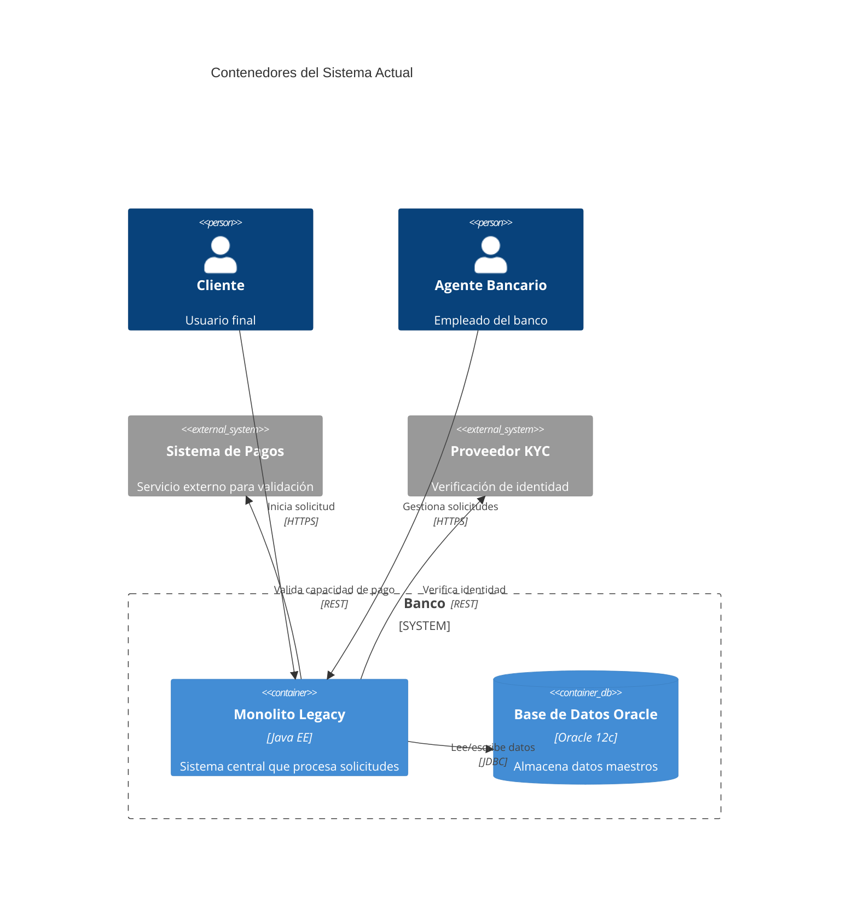
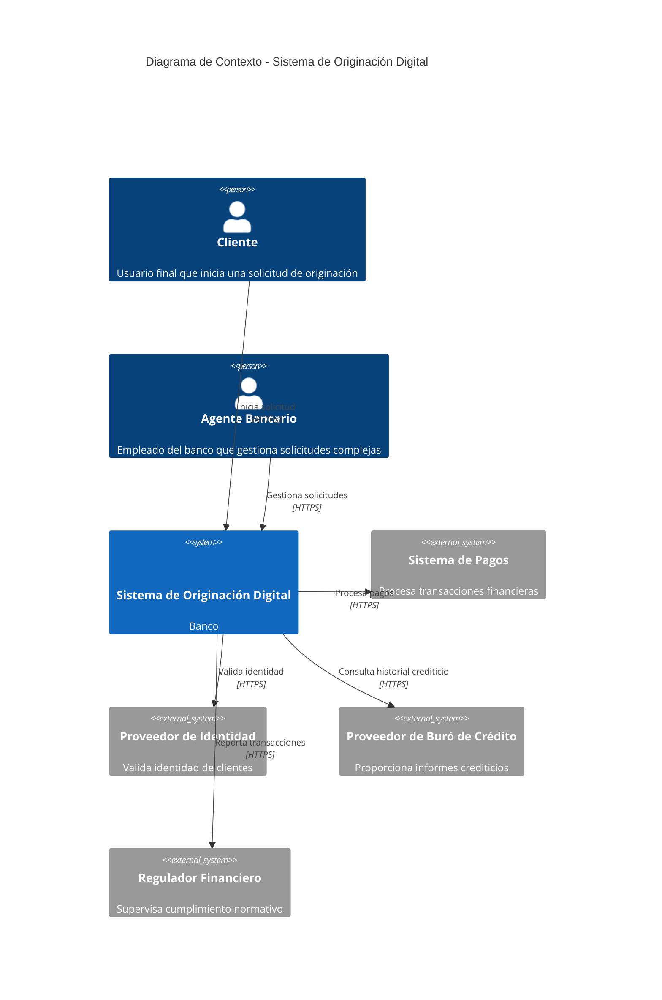

# Prompt para Mejorar el Codigo Base

Copia y pega el contenido del bloque de abajo en un asistente de IA (Claude, ChatGPT)
para obtener un ZIP con el proyecto completo y arrancable.

Si preferis trabajar en tu editor con un agente local (Claude Code, Cursor, Copilot), usa `AGENTS.md` en vez de este archivo: dice lo mismo pero para que escriba los archivos en disco.

## Las dos reglas que no se negocian

1. **Completa el boilerplate.** Todo lo que el proyecto necesita para compilar y arrancar: manifiesto de dependencias, punto de entrada, configuracion, capa de interfaz, y las capas del patron arquitectonico declarado. Eso es andamiaje y es tu trabajo.
2. **NO resuelvas el reto.** Los entregables de las fases son el trabajo de la persona. El hueco pedagogico se deja como esta: el proyecto arranca, pero lo que el reto pide implementar NO esta implementado.

Dicho de otra forma: si algo impide compilar, arreglalo. Si algo es logica de negocio incompleta, validaciones ausentes, un secreto hardcodeado o un patron mejorable, dejalo exactamente como esta — es lo que la persona tiene que encontrar.

## Superficie de practica — NO resuelvas

Estos archivos SON el ejercicio de la persona. No los implementes; deja stubs.

- `adr/001-estrategia-resiliencia.md` — El topic pide resiliencia: este archivo es el ejercicio.
- `poc/serverless-resilience.js` — El topic pide resiliencia: este archivo es el ejercicio.
- `adr/002-seguridad-pci-dss.md` — El topic pide decisiones de arquitectura: el ADR es el ejercicio.

## Como saber que terminaste

```bash
python3 -c "import glob,sys; assert glob.glob('adr/*.md') and glob.glob('diagramas/*.mmd'), 'faltan ADRs o diagramas'"
```

Ese comando corriendo sin errores es la definicion de "listo".

---

```
## Briefing del reto (autoridad)
Este bloque manda sobre los archivos adjuntos. El stack y el rol salen de AQUÍ, no de un topic genérico ni de markdown placeholder.

### Perfil
Chapter Arquitectura, Especialidad Soluciones, Seniority Seniority Advanced

### Brecha de conocimiento
Sostiene las decisiones de arquitectura con atributos de calidad medibles y trade-offs explicitos

### Misión / candidato
Diseñar la solucion de originacion digital

### Datos adicionales
Candidato con 8 años de experiencia

### Reto
- Tema: Diseño de solucion de extremo a extremo (e2e s1 pdn)
- Seniority: advanced-l2
- Tipo: mixed
- Título: Diseño de la solución de originación digital
- Tiempo estimado: 180 minutos

### Fases (trabajo del HUMANO — PROHIBIDO completarlas)
No implementes estos entregables. Dejalos como hueco pedagógico. El asistente solo materializa el proyecto arrancable para que el participante pueda trabajar.
- Fase 1: Análisis de Requisitos y ASRs — objetivo: Identificar y analizar los ASRs y los drivers de calidad para la solución de originación digital. — entregable (NO resolver): Lista de ASRs y drivers de calidad con restricciones técnicas y de negocio.
- Fase 2: Diseño de la Arquitectura — objetivo: Diseñar la arquitectura de la solución de originación digital, aplicando patrones y estilos arquitectónicos modernos. — entregable (NO resolver): Diagrama de la arquitectura con patrones y estilos aplicados, y tácticas de resiliencia.
- Fase 3: Evaluación de Trade-offs y ADR — objetivo: Evaluar los trade-offs y documentar las decisiones arquitectónicas en un ADR. — entregable (NO resolver): ADR formal con trade-offs explícitos y discusión de riesgos residuales.
- Fase 4: Validación y Entrega — objetivo: Validar la solución diseñada y asegurar que cumple con los ASRs y drivers de calidad. — entregable (NO resolver): Documento final de diseño con todos los diagramas, ADR y documentación relevante.

Eres un asistente experto en análisis, corrección y generación de archivos de cualquier tipo:
código fuente, documentación, hojas de cálculo, documentos Word, configuraciones, entre otros.
Voy a enviarte una cadena de texto que contiene uno o más archivos. Cada archivo está delimitado por un marcador con el siguiente formato:
// === ARCHIVO: ruta/del/archivo.extension ===
o también puede aparecer como:
## === ARCHIVO: ruta/del/archivo.extension ===
Lo que sigue al marcador puede ser:

El contenido real del archivo (código, texto, YAML, etc.)
Una descripción en lenguaje natural de lo que debe contener el archivo


TU TAREA
PASO 0 — ¿Esto es un proyecto o una carcasa?
Antes de extraer archivos, leé el Briefing (si está) y diagnosticá el adjunto.

Es CARCASA si ocurre CUALQUIERA de estas:
- No hay manifiesto de dependencias del stack del briefing (manifest.json de VTEX IO / package.json / pom.xml / build.gradle / requirements.txt / go.mod / *.tf / *.csproj, según corresponda)
- Hay un "binario" que en realidad es un comentario ("no puede ser mostrado como texto plano", placeholder .fig/.docx vacío)
- Los markdowns ya completan entregables de fases posteriores ("se implementó fade-in", lista de áreas ya resuelta)

Si es CARCASA:
- MATERIALIZÁ un proyecto que arranca en el stack del briefing (VTEX IO Store Framework, Angular, Terraform, pytest, Nest, etc.). Incluí manifiesto, punto de entrada y capa de interfaz reales.
- NO copies los markdowns de "solución" como si fueran el producto. Son ruido de generación.
- NO resuelvas las fases del briefing (están marcadas PROHIBIDO). Dejá el hueco pedagógico: el flujo existe, las microinteracciones/calidad/infra que el reto pide NO están hechas.
- Después seguí al PASO 5 (ZIP).

Si es un proyecto REAL (manifiesto + código que compila o arranca):
- Seguí PASO 1 en adelante. 🔴 compilación sí. 🟡 pedagógico no.

PASO 1 — Detección y extracción
Identifica todos los archivos presentes en la cadena. Para cada archivo extrae:

Su ruta completa (ej: src/main/java/com/pragma/Service.java)
Su contenido o descripción

PASO 2 — Clasificación por tipo
Clasifica cada archivo en una de estas categorías:
A) Código fuente (Java, Python, TypeScript, JavaScript, Kotlin, etc.)
B) Configuración / documentación (YAML, properties, Markdown, JSON, txt, etc.)
C) Excel (.xlsx, .xls, .csv)
D) Word (.docx, .doc)
E) Otro tipo de archivo binario o especial
PASO 3 — Clasificación de errores en código fuente

Objetivo prioritario: que el proyecto compile. No corrijas flujo de negocio ni lógica funcional.

Antes de modificar cualquier archivo de código fuente, clasifica cada problema encontrado en una de estas dos categorías:
🔴 ERROR DE COMPILACIÓN — corregir siempre
Son errores que impiden que el proyecto arranque, sin valor pedagógico:

Import faltante o incorrecto
Clase, método o variable referenciada que no existe en ningún archivo del proyecto
Error de sintaxis
Anotación con atributos inválidos
Dependencia ausente en pom.xml, package.json, etc.
Archivo referenciado que no existe y debe ser creado con implementación mínima

→ CORREGIR estos errores.
🟡 PROBLEMA FUNCIONAL O DE CALIDAD — preservar siempre
Son problemas que no impiden compilar. Pueden ser intencionales para el aprendizaje:

Clave secreta hardcodeada ("secret", "password123")
API deprecada que funciona pero tiene reemplazo moderno
Lógica de negocio incorrecta o incompleta
Código redundante o de baja legibilidad
Falta de validaciones en flujo de negocio
Patrones de diseño incorrectos pero funcionales
Concurrencia no segura
Configuración funcional pero no óptima

→ PRESERVAR tal cual. No corregir, no mejorar, no comentar.
PASO 4 — Procesamiento según tipo de archivo
Tipo A — Código fuente
Aplica únicamente las correcciones clasificadas como 🔴 ERROR DE COMPILACIÓN.
No alteres ningún elemento clasificado como 🟡 PROBLEMA FUNCIONAL O DE CALIDAD.
Si falta un archivo referenciado, créalo con la implementación mínima necesaria para compilar.
Tipo B — Configuración / documentación
Extrae el contenido tal cual, sin modificaciones salvo errores evidentes de sintaxis
(ej: YAML mal indentado).
Tipo C — Excel (.xlsx)
Si viene con contenido real, genera el archivo respetando ese contenido.
Si viene con descripción en lenguaje natural, genera un archivo Excel funcional con:

Fila de encabezados en negrita con color de fondo distintivo
Columnas con ancho ajustado al contenido
Tipos de dato correctos por columna
Validaciones si la descripción lo indica
Hojas nombradas descriptivamente si hay más de una
Filas de ejemplo si no hay datos reales

Tipo D — Word (.docx)
Si viene con contenido real, genera el archivo respetando ese contenido.
Si viene con descripción en lenguaje natural, genera un documento Word funcional con:

Estilos de título (Título 1, Título 2) para jerarquía de secciones
Fuente legible (Calibri o equivalente), tamaño 11-12pt para cuerpo
Márgenes estándar
Tabla de contenido si tiene múltiples secciones
Tablas con encabezados en negrita si aplica

Tipo E — Otro
Genera el archivo con el contenido o estructura más apropiada según la descripción.
PASO 5 — Exportación en ZIP
Empaqueta todos los archivos en un único archivo ZIP descargable respetando exactamente
la estructura de rutas indicada por los marcadores.
El ZIP debe incluir:

Archivos de código con únicamente los errores de compilación corregidos
Archivos de configuración y documentación sin cambios
Archivos nuevos creados para resolver dependencias de compilación faltantes
Archivos Excel y Word generados desde descripción

IMPORTANTE: El ZIP debe estar listo para descargar al finalizar. No preguntes si el usuario
quiere generarlo. Simplemente genera el archivo y proporciona el enlace de descarga; No debes desplegar en el chat el resumen de lo que arreglaste al Zip, solo entregalo.

REGLAS IMPORTANTES

No omitas ningún archivo aunque no tenga errores ni modificaciones
Respeta los nombres y rutas exactas indicadas por los marcadores
Si un archivo no tiene marcador claro, infiere el nombre desde su contenido
Si la cadena contiene solo documentación, placeholders o binarios fake, NO la reproduzcas:
aplicá PASO 0 (materializar el proyecto del briefing). Reproducir la carcasa es un fallo.
No agregues texto después del enlace de descarga del ZIP
No preguntes si el usuario quiere el ZIP: simplemente generalo siempre
Si detectas que falta un archivo de configuración necesario para compilar
(pom.xml, package.json, requirements.txt, build.gradle, etc.), créalo e inclúyelo
inferiendo su contenido desde los imports y frameworks detectados en el código
Nunca corrijas problemas 🟡 aunque parezcan obvios o fáciles de mejorar.
El participante que recibirá este proyecto los debe encontrar y resolver él mismo.


INPUT
Aquí está la cadena con los archivos:

// === ARCHIVO: atributos-de-calidad.md ===
# Atributos de Calidad y Escenarios

## Requisitos Arquitectónicamente Significativos (ASRs)

| ID  | ASR                                                                 | Valor Medible                                  |
|-----|---------------------------------------------------------------------|-----------------------------------------------|
| ASR-01 | La solución debe soportar un tráfico pico de transacciones          | 50.000 TPS                                     |
| ASR-02 | El tiempo de respuesta debe ser menor al percentil 99               | p99 < 100 ms                                   |
| ASR-03 | La solución debe tolerar fallos de red sin pérdida de datos         | Tolerancia de 1 hora                           |
| ASR-04 | Cumplimiento con estándares de seguridad PCI DSS                    | Certificación PCI DSS Nivel 1                  |
| ASR-05 | Escalabilidad horizontal para manejar crecimiento en demanda        | Escalar a 100.000 TPS con aumento lineal de costos |

## Escenarios de Calidad

Los escenarios siguen la estructura de 6 partes según ISO 25010:
1. **Fuente**: Quien o qué genera el estímulo.
2. **Estímulo**: Evento o condición que requiere respuesta.
3. **Artefacto**: Sistema o componente afectado.
4. **Entorno**: Contexto en el que ocurre el estímulo.
5. **Respuesta**: Comportamiento observable del sistema.
6. **Medida**: Métrica para evaluar la respuesta.

### Tabla de Escenarios

| ID  | Escenario                                                                 | Fuente               | Estímulo                          | Artefacto                  | Entorno               | Respuesta                          | Medida                          |
|-----|---------------------------------------------------------------------------|------------------------|-----------------------------------|-------------------------------|--------------------------|-----------------------------------|--------------------------------|
| ESC-01 | Alto tráfico de transacciones durante hora pico                            | Clientes               | 50.000 TPS                        | Originación Digital          | Producción              | Manejar transacciones sin degradación | p99 < 100 ms                  |
| ESC-02 | Fallo de red en una región                                               | Proveedor de Red       | Corte de conectividad             | Originación Digital          | Producción              | Mantener operaciones en otras regiones | Tolerancia de 1 hora          |
| ESC-03 | Intento de acceso no autorizado                                           | Actor Malicioso        | Ataque de fuerza bruta            | API de Originación           | Producción              | Bloquear acceso y registrar evento     | Tasa de falsos positivos < 1% |
| ESC-04 | Crecimiento inesperado de demanda                                         | Clientes               | Aumento del 100% en demanda       | Originación Digital          | Producción              | Escalar recursos automáticamente       | Tiempo de escalado < 5 minutos |
| ESC-05 | Validación de datos sensibles según PCI DSS                               | Cliente                | Envío de datos de tarjeta         | Módulo de Seguridad           | Producción              | Validar y encriptar datos              | Cumplimiento PCI DSS Nivel 1  |

> **Preguntas guía para completar los escenarios:**
> - ¿Qué otros escenarios de calidad son críticos para este sistema?
> - ¿Cómo afectan estos escenarios a los ASRs identificados?
> - ¿Qué métricas adicionales podrían ser relevantes para medir la respuesta del sistema?

// === ARCHIVO: arquitectura.md ===
# Arquitectura de la Solución de Originación Digital

## Vistas Arquitectónicas

### 1. Vista de Contexto

> **Preguntas guía:**
> - ¿Qué actores externos interactúan con el sistema de originación digital?
> - ¿Cuáles son los límites del sistema y sus relaciones con otros sistemas?
> - ¿Qué protocolos de comunicación se utilizan en las fronteras del sistema?

El diagrama de contexto se encuentra en `diagramas/contexto.mmd`.

### 2. Vista de Contenedores

> **Preguntas guía:**
> - ¿Qué contenedores componen el sistema de originación digital?
> - ¿Cómo se comunican estos contenedores entre sí?
> - ¿Qué tecnologías se utilizan para implementar cada contenedor?

Descripción de los contenedores:

| Contenedor               | Responsabilidad                                                                 | Tecnología               |
|--------------------------|-------------------------------------------------------------------------------|--------------------------|
| API Gateway              | Enrutamiento de solicitudes, autenticación y balanceo de carga              | AWS API Gateway          |
| Servicio de Originación | Lógica de negocio para la originación de productos financieros              | AWS Lambda               |
| Base de Datos            | Almacenamiento persistente de transacciones y datos de clientes             | Amazon Aurora PostgreSQL |
| Cola de Eventos          | Mensajería asíncrona para procesamiento de transacciones                    | Amazon SQS               |
| Servicio de Seguridad    | Validación de datos sensibles y cumplimiento de PCI DSS                     | AWS Lambda + AWS KMS     |
| Servicio de Notificaciones| Envío de notificaciones a clientes y sistemas externos                      | Amazon SNS               |

### 3. Vista de Componentes

> **Preguntas guía:**
> - ¿Qué componentes forman parte del Servicio de Originación?
> - ¿Cómo interactúan estos componentes para cumplir con los ASRs?
> - ¿Qué patrones arquitectónicos se aplican en esta vista?

Descripción de los componentes del **Servicio de Originación**:

| Componente               | Responsabilidad                                                                 | Patrón Arquitectónico    |
|--------------------------|-------------------------------------------------------------------------------|--------------------------|
| Módulo de Validación     | Validación de datos de entrada                                               | Strategy                 |
| Módulo de Procesamiento  | Lógica de negocio para la originación de productos                           | Pipeline                 |
| Módulo de Persistencia   | Interacción con la base de datos                                             | Repository               |
| Módulo de Resiliencia    | Manejo de fallos y reintentos                                                 | Circuit Breaker          |
| Módulo de Auditoría      | Registro de eventos y transacciones                                           | Event Sourcing           |

### 4. Vista de Despliegue

> **Preguntas guía:**
> - ¿Cómo se despliega la solución en múltiples regiones para garantizar alta disponibilidad?
> - ¿Qué estrategias de despliegue se utilizan para cumplir con los ASRs de escalabilidad y resiliencia?
> - ¿Cómo se gestionan los fallos en una región específica?

Descripción del despliegue:

- **Regiones**: La solución se despliega en al menos 3 regiones de AWS para garantizar alta disponibilidad.
- **Balanceo de Carga**: Se utiliza AWS Global Accelerator para distribuir el tráfico entre regiones.
- **Base de Datos**: Amazon Aurora PostgreSQL con replicación multi-región y failover automático.
- **Cola de Eventos**: Amazon SQS con colas replicadas entre regiones.
- **Monitorización**: Amazon CloudWatch para métricas y logs, con alarmas configuradas para eventos críticos.

### 5. Tácticas Arquitectónicas

> **Preguntas guía:**
> - ¿Qué tácticas se aplican para cumplir con los ASRs de disponibilidad y resiliencia?
> - ¿Cómo se manejan los fallos en los componentes críticos?
> - ¿Qué estrategias de escalabilidad se implementan para manejar el crecimiento de demanda?

| Táctica                  | Descripción                                                                     | ASR Relacionado          |
|--------------------------|-------------------------------------------------------------------------------|--------------------------|
| Reintentos con Backoff   | Reintentos exponenciales para operaciones fallidas                            | ASR-03                   |
| Circuit Breaker          | Detener solicitudes a servicios fallidos para evitar cascadas                | ASR-03                   |
| Escalado Horizontal      | Añadir instancias de Lambda para manejar aumento de demanda                  | ASR-05                   |
| Réplicas Multi-Región    | Réplicas de bases de datos y colas en múltiples regiones                     | ASR-03                   |
| Validación de Datos      | Validación de datos sensibles según estándares PCI DSS                       | ASR-04                   |

// === ARCHIVO: riesgos-y-mitigaciones.md ===
# Matriz de Riesgos y Mitigaciones

## Riesgos Identificados

| ID  | Riesgo                                                                         | Probabilidad (Alta/Media/Baja) | Impacto (Alto/Medio/Bajo) | Tratamiento                     |
|-----|--------------------------------------------------------------------------------|--------------------------------|--------------------------|-------------------------------|
| R-01 | Fallo en la replicación multi-región de la base de datos                      | Media                         | Alto                     |                                |
| R-02 | Sobrecarga del API Gateway durante picos de tráfico                           | Alta                          | Alto                     |                                |
| R-03 | Incumplimiento de PCI DSS por errores en la validación de datos               | Baja                          | Alto                     |                                |
| R-04 | Latencia alta en la cola de eventos debido a saturación                       | Media                         | Medio                    |                                |
| R-05 | Fallo en el servicio de notificaciones durante un corte de red                | Baja                          | Medio                    |                                |
| R-06 | Ataques de denegación de servicio (DDoS)                                      | Alta                          | Alto                     |                                |

> **Preguntas guía para completar la matriz:**
> - ¿Qué otros riesgos podrían afectar la solución de originación digital?
> - ¿Cómo se priorizan estos riesgos según su probabilidad e impacto?
> - ¿Qué estrategias de mitigación se pueden implementar para cada riesgo identificado?
> - ¿Qué riesgos residuales quedan después de aplicar las mitigaciones?

## Estrategias de Mitigación

| ID  | Estrategia de Mitigación                                                      | Riesgo Relacionado         |
|-----|-------------------------------------------------------------------------------|----------------------------|
| M-01 | Implementar réplicas multi-región con failover automático                    | R-01                       |
| M-02 | Configurar auto-scaling para el API Gateway y servicios Lambda               | R-02                       |
| M-03 | Auditorías continuas de cumplimiento PCI DSS y validación de datos           | R-03                       |
| M-04 | Monitoreo en tiempo real de la cola de eventos para detectar saturación      | R-04                       |
| M-05 | Configurar colas de notificaciones con réplicas en múltiples regiones        | R-05                       |
| M-06 | Implementar AWS Shield para protección contra DDoS                           | R-06                       |

// === ARCHIVO: rubrica-autoevaluacion.md ===
# Rúbrica de Autoevaluación

## Criterios de Evaluación

| Criterio                          | Excelente (5)                                                                 | Aceptable (3)                                                              | Insuficiente (1)                                                          |
|-----------------------------------|-------------------------------------------------------------------------------|----------------------------------------------------------------------------|----------------------------------------------------------------------------|
| **Alineación con ASRs**           | Todos los ASRs están claramente identificados y respaldados con métricas.   | La mayoría de los ASRs están identificados pero faltan métricas claras.   | Los ASRs no están claramente identificados o no tienen métricas asociadas. |
| **Uso de Patrones y Herramientas**| La arquitectura aplica patrones modernos y herramientas adecuadas para cumplir con los ASRs. | Se aplican algunos patrones pero no todos son relevantes para los ASRs. | No se aplican patrones arquitectónicos o son inadecuados para los ASRs.    |
| **Calidad de Diagramas**         | Los diagramas son claros, completos y siguen la notación C4.                | Los diagramas son claros pero faltan detalles importantes.                | Los diagramas son incompletos o no siguen la notación C4.                  |
| **Calidad de ADR**               | Los ADRs están bien documentados con contexto, fuerzas, opciones y trade-offs. | Los ADRs están documentados pero faltan detalles en opciones o trade-offs. | Los ADRs son incompletos o no siguen el formato MADR.                      |
| **Viabilidad**                   | La solución es viable técnica y económicamente, con riesgos mitigados.      | La solución es viable pero con riesgos significativos no mitigados.       | La solución no es viable técnica o económicamente.                         |

## Instrucciones para la Autoevaluación

1. **Revisa cada criterio** y asigna una puntuación según tu evaluación.
2. **Documenta las razones** para cada puntuación en la columna correspondiente.
3. **Identifica áreas de mejora** y propón acciones concretas para alcanzarlas.
4. **Entrega la rúbrica** junto con el resto de la documentación del reto.

> **Nota:** Esta rúbrica es una herramienta para reflexionar sobre tu diseño y mejorar tu solución. No es un mecanismo de calificación automática, sino una guía para asegurar que cumples con los objetivos del reto.

// === ARCHIVO: adr/001-estrategia-resiliencia.md ===
# ADR 001: Estrategia de Resiliencia para Originación Digital

Estado: Propuesto
Fecha: 2023-11-15

## Contexto

El sistema de originación digital debe soportar un tráfico pico de **50.000 TPS** con un tiempo de respuesta **p99 < 100 ms** y tolerar fallos de red durante **1 hora** sin pérdida de datos. La solución se despliega en múltiples regiones de AWS para garantizar alta disponibilidad y resiliencia.

Las restricciones incluyen:
- **Cumplimiento de PCI DSS** para manejo de datos sensibles.
- **Escalabilidad horizontal** para manejar crecimiento en demanda.
- **Alta disponibilidad** con replicación multi-región.

## Fuerzas

- **Disponibilidad**: El sistema debe estar operativo el 99.99% del tiempo, incluso durante fallos de red o cortes en una región.
- **Resiliencia**: Debe recuperarse automáticamente de fallos sin intervención manual.
- **Rendimiento**: El tiempo de respuesta debe mantenerse bajo incluso durante picos de tráfico.
- **Costo**: La solución debe ser costo-efectiva, evitando sobre-provisión de recursos.
- **Seguridad**: Cumplimiento con PCI DSS y protección contra ataques maliciosos.

> **Preguntas guía:**
> - ¿Qué estrategias de resiliencia son más efectivas para cumplir con los ASRs?
> - ¿Cómo se manejan los fallos en los componentes críticos del sistema?
> - ¿Qué trade-offs existen entre disponibilidad, rendimiento y costo en esta solución?

## Opciones consideradas

> **Preguntas guía:**
> - ¿Qué alternativas evaluarías para implementar resiliencia en este sistema?
> - ¿Qué pros y contras tiene cada alternativa frente a los ASRs y las fuerzas identificadas?
> - ¿Cuáles descartarías y por qué?

## Decision

> **Preguntas guía:**
> - ¿Qué estrategia de resiliencia eliges y con qué criterios medibles?
> - ¿Cómo aseguras que la solución cumple con los ASRs de disponibilidad y rendimiento?

## Consecuencias

> **Preguntas guía:**
> - ¿Qué impacto tiene la estrategia elegida en los ASRs y las fuerzas identificadas?
> - ¿Qué riesgos residuales quedan y cómo se mitigan?
> - ¿Cómo se monitorea y valida el cumplimiento de los ASRs en producción?

// === ARCHIVO: adr/002-seguridad-pci-dss.md ===
# ADR 002: Estrategia de Seguridad para Cumplimiento PCI DSS

Estado: Propuesto
Fecha: 2023-11-15

## Contexto

El sistema de originación digital maneja datos sensibles de tarjetas de crédito y debe cumplir con los estándares **PCI DSS Nivel 1**. Esto incluye:
- **Validación y encriptación** de datos sensibles.
- **Autenticación y autorización** robustas.
- **Monitoreo y auditoría** continuos de accesos y transacciones.
- **Protección contra ataques** como inyección de SQL, XSS y CSRF.

La solución se despliega en AWS, lo que permite aprovechar servicios gestionados para cumplir con estos requisitos.

## Fuerzas

- **Seguridad**: Protección de datos sensibles y cumplimiento con PCI DSS.
- **Rendimiento**: La seguridad no debe degradar el tiempo de respuesta (p99 < 100 ms).
- **Costo**: La solución debe ser costo-efectiva, evitando soluciones sobre-dimensionadas.
- **Operatividad**: Las prácticas de seguridad deben integrarse en el ciclo de vida DevSecOps.
- **Escalabilidad**: La solución debe escalar sin comprometer la seguridad.

> **Preguntas guía:**
> - ¿Qué estrategias de seguridad son necesarias para cumplir con PCI DSS?
> - ¿Cómo se integran estas estrategias en el ciclo de vida DevSecOps?
> - ¿Qué trade-offs existen entre seguridad, rendimiento y costo?

## Opciones consideradas

> **Preguntas guía:**
> - ¿Qué alternativas evaluarías para implementar seguridad en este sistema?
> - ¿Qué pros y contras tiene cada alternativa frente a los ASRs y las fuerzas identificadas?
> - ¿Cuáles descartarías y por qué?

## Decision

> **Preguntas guía:**
> - ¿Qué estrategia de seguridad eliges y con qué criterios medibles?
> - ¿Cómo aseguras que la solución cumple con PCI DSS sin degradar el rendimiento?

## Consecuencias

> **Preguntas guía:**
> - ¿Qué impacto tiene la estrategia elegida en los ASRs y las fuerzas identificadas?
> - ¿Qué riesgos residuales quedan y cómo se mitigan?
> - ¿Cómo se valida el cumplimiento continuo de PCI DSS en producción?


// === ARCHIVO: atributos-de-calidad.md ===
# Atributos de Calidad y Escenarios

## Contexto
El sistema de originación digital del banco debe soportar operaciones críticas en múltiples regiones con altos estándares de rendimiento, disponibilidad y seguridad. Los siguientes ASRs (Requisitos Arquitectónicamente Significativos) son mandatorios:

| ASR | Valor Medible |
|-----|---------------|
| Disponibilidad | 99.99% en horario comercial (Lunes a Viernes, 8:00 AM - 6:00 PM)
| Rendimiento | 50.000 TPS con p99 < 100 ms |
| Resiliencia | Tolerancia a fallos de red de al menos 1 hora sin pérdida de datos |
| Seguridad | Cumplimiento PCI DSS 4.0 (todos los controles aplicables) |
| Escalabilidad | Capacidad de escalar horizontalmente para manejar picos de tráfico del 200% |

## Escenarios de Calidad
Completa la tabla con escenarios de calidad siguiendo el formato ISO 25010 (fuente, estímulo, artefacto, entorno, respuesta, medida).

### Tabla de Escenarios
| Fuente | Estímulo | Artefacto | Entorno | Respuesta | Medida |
|--------|----------|-----------|---------|-----------|--------|
| Cliente | Inicia solicitud de préstamo | API de originación | Tráfico pico (50.000 TPS) | Sistema procesa la solicitud | p99 < 100 ms |
| > Preguntas guía: ¿Qué actores externos podrían generar estímulos? ¿Qué artefactos del sistema se ven afectados? ¿Cómo responde el sistema bajo condiciones normales vs. pico?
| 
| Sistema de Pagos | Fallo en conexión | Servicio de validación de capacidad de pago | Operación normal | Servicio degrada funcionalidad sin perder datos | Tiempo de recuperación < 1 hora |
| > Preguntas guía: ¿Qué mecanismos de resiliencia se activan durante un fallo? ¿Cómo se garantiza la consistencia de los datos?
| 
| Proveedor Externo | Respuesta lenta (latencia > 500 ms) | Servicio de verificación de identidad | Tráfico moderado | Sistema usa caché local o fallback | Porcentaje de éxito > 95% |
| > Preguntas guía: ¿Qué estrategias de mitigación existen para dependencias externas? ¿Cómo se priorizan las respuestas?
| 
| Agente Bancario | Envía solicitud fraudulenta | API de originación | Horario comercial | Sistema rechaza la solicitud y alerta al equipo de seguridad | Tasa de detección > 99% |
| > Preguntas guía: ¿Qué controles de seguridad se aplican? ¿Cómo se registran y escalan los incidentes?
| 
| Base de Datos Principal | Sobrecarga (CPU > 90%) | Repositorio de solicitudes | Tráfico pico | Sistema escala horizontalmente y balancea carga | Tiempo de escalado < 2 minutos |
| > Preguntas guía: ¿Qué patrones de escalabilidad se implementan? ¿Cómo se monitorea el rendimiento?

## Drivers de Calidad
- **Disponibilidad**: El sistema debe estar disponible durante el horario comercial con redundancia multi-región.
- **Rendimiento**: Las transacciones deben completarse en menos de 100 ms incluso en picos de tráfico.
- **Resiliencia**: El sistema debe recuperarse de fallos sin pérdida de datos y con mínima degradación.
- **Seguridad**: Cumplimiento estricto de PCI DSS 4.0, incluyendo cifrado de datos en tránsito y reposo.
- **Escalabilidad**: Capacidad de escalar dinámicamente para manejar aumentos repentinos de demanda.

> Preguntas guía:
> - ¿Qué tácticas arquitectónicas usarías para garantizar cada driver?
> - ¿Cómo priorizarías estos drivers en caso de conflicto?
> - ¿Qué métricas usarías para validar el cumplimiento de cada ASR?

// === ARCHIVO: README.md ===
# Originación Digital - Banco Multi-Región

## Contexto del Negocio
El banco requiere modernizar su proceso de originación de productos financieros (préstamos, tarjetas, cuentas) para ofrecer una experiencia 100% digital, multi-región y escalable. Actualmente, el proceso depende de sucursales físicas y sistemas legacy con limitaciones de rendimiento y disponibilidad.

### Actores
- **Clientes**: Usuarios finales que inician solicitudes de productos financieros.
- **Agentes Bancarios**: Empleados que gestionan solicitudes complejas o excepciones.
- **Sistema de Pagos**: Servicio externo para validar capacidad de pago.
- **Proveedores de Servicios Externos**: Terceros para verificación de identidad (KYC) y scoring crediticio.
- **Equipo de Seguridad**: Monitorea y responde a incidentes de fraude.
- **Equipo de Operaciones**: Gestiona la disponibilidad y rendimiento del sistema.

### Restricciones
- **Técnicas**: 
  - Integración con sistemas legacy (core bancario) vía APIs REST.
  - Uso de AWS como proveedor cloud principal (multi-región).
  - Cumplimiento PCI DSS 4.0 para manejo de datos sensibles.
  - Latencia máxima de 100 ms para transacciones.
- **De Negocio**:
  - Tiempo de implementación: 6 meses.
  - Presupuesto limitado para infraestructura adicional.
  - Soporte para 5 regiones geográficas con regulaciones locales.

### ASRs (Requisitos Arquitectónicamente Significativos)
| ASR | Valor Medible | Justificación |
|-----|---------------|---------------|
| Disponibilidad | 99.99% en horario comercial | Minimizar impacto en experiencia del cliente |
| Rendimiento | 50.000 TPS con p99 < 100 ms | Manejar picos de tráfico sin degradación |
| Resiliencia | Tolerancia a fallos de red de 1 hora | Garantizar continuidad operativa durante cortes |
| Seguridad | Cumplimiento PCI DSS 4.0 | Proteger datos sensibles y evitar multas |
| Escalabilidad | Escalar al 200% en < 2 minutos | Adaptarse a crecimiento orgánico e inorgánico |

### Estructura del Proyecto
```
originacion-digital/
├── adr/                  # Decision Records (ADRs)
│   ├── 001-estrategia-resiliencia.md
│   └── 002-seguridad-pci-dss.md
├── arquitectura.md       # Vistas C4 y descripción del sistema actual
├── atributos-de-calidad.md
├── diagramas/            # Diagramas en Mermaid
│   └── contexto.mmd
├── contratos/            # Especificaciones OpenAPI
│   └── api-originacion.yaml
├── poc/                  # Prueba de concepto (opcional)
│   ├── serverless-resilience.js
│   └── README.md
├── riesgos-y-mitigaciones.md
└── rubrica-autoevaluacion.md
```

### Entrega
El candidato debe completar:
1. **ADRs**: Analizar opciones, tomar decisiones y documentar consecuencias.
2. **Diagramas C4**: Dibujar vistas de contenedores, componentes y despliegue.
3. **Escenarios de Calidad**: Completar la tabla en `atributos-de-calidad.md`.
4. **Riesgos**: Priorizar riesgos en `riesgos-y-mitigaciones.md`.
5. **PoC (opcional)**: Refactorizar o completar el código en `poc/`.

> **Formato de Entrega**: Archivos Markdown con las secciones completadas y diagramas en Mermaid.
> **Herramientas Recomendadas**: VS Code con plugins para Mermaid, Draw.io.

### Cómo Empezar
1. **Revisa el caso**: Lee el `README.md` y `atributos-de-calidad.md` para entender los ASRs y restricciones.
2. **Analiza el sistema actual**: Estudia `arquitectura.md` y `diagramas/contexto.mmd`.
3. **Completa los ADRs**: Enfócate en `adr/001-estrategia-resiliencia.md` y `adr/002-seguridad-pci-dss.md`.
4. **Diseña la solución**: Actualiza `arquitectura.md` con las vistas C4 propuestas.
5. **Evalúa riesgos**: Prioriza riesgos en `riesgos-y-mitigaciones.md`.
6. **Opcional**: Refactoriza el PoC en `poc/serverless-resilience.js`.

> **Comando de Verificación**:
```bash
python3 -c "import glob,sys; assert glob.glob('adr/*.md') and glob.glob('diagramas/*.mmd'), 'Faltan ADRs o diagramas'"
```

// === ARCHIVO: arquitectura.md ===
# Arquitectura del Sistema de Originación Digital

## 1. Vista de Contexto
El sistema actual (as-is) está basado en un monolito legado con las siguientes características:
- **Sistema Legacy Core Bancario**: Procesa todas las transacciones y almacena datos maestros.
- **Sucursales Físicas**: Puntos de contacto principales para clientes.
- **Proveedores Externos**: Servicios de KYC y scoring crediticio.
- **Sistema de Pagos**: Validación de capacidad de pago.

El diagrama de contexto (`diagramas/contexto.mmd`) muestra las interacciones actuales entre estos actores.

> **Preguntas guía**:
> - ¿Qué actores adicionales deberían incluirse en el contexto del sistema propuesto?
> - ¿Cómo afectan las restricciones técnicas y de negocio a las interacciones entre actores?

## 2. Vista de Contenedores (Sistema Actual - As-Is)
El sistema actual se compone de los siguientes contenedores:



### Limitaciones del Sistema Actual
- **Rendimiento**: El monolito no escala horizontalmente, limitando el throughput.
- **Disponibilidad**: Dependencia de la base de datos Oracle (SPOF).
- **Resiliencia**: Sin mecanismos de fallback para dependencias externas.
- **Seguridad**: Datos sensibles en texto plano; falta de cifrado en tránsito.

> **Preguntas guía para la Vista To-Be**:
> - ¿Qué contenedores propondrías para reemplazar el monolito?
> - ¿Cómo garantizarías la escalabilidad y resiliencia de cada contenedor?
> - ¿Qué patrones arquitectónicos aplicarías (ej. microservicios, serverless)?

## 3. Vista de Contenedores (Sistema Propuesto - To-Be)
> **Preguntas guía**:
> - Dibuja los contenedores de la solución propuesta usando Mermaid.
> - Incluye:
>   - API Gateway
>   - Microservicios (originación, scoring, KYC)
>   - Bases de datos (SQL/NoSQL)
>   - Colas de mensajes (Kafka, SQS)
>   - Servicios serverless (Lambda, Step Functions)
>   - Cache (Redis, DynamoDB)
> - ¿Cómo interactúan los contenedores entre sí?
> - ¿Qué protocolos de comunicación usarías (REST, gRPC, eventos)?

## 4. Vista de Componentes
### Componente: API de Originación
**Responsabilidades**:
- Validar solicitudes de clientes.
- Orquestar flujos con otros servicios.
- Manejar errores y reintentos.

> **Preguntas guía**:
> - ¿Qué componentes internos tendría la API de originación?
> - ¿Cómo se comunica con otros contenedores (ej. scoring, KYC)?
> - ¿Qué patrones usarías para manejar la resiliencia (ej. circuit breaker, retry)?

### Componente: Servicio de Scoring
**Responsabilidades**:
- Calcular score crediticio.
- Integrar con proveedores externos.

> **Preguntas guía**:
> - ¿Cómo garantizarías la consistencia eventual en el scoring?
> - ¿Qué estrategias usarías para manejar latencias altas en proveedores externos?

## 5. Vista de Despliegue
### Infraestructura Actual (As-Is)
- Todo el sistema se despliega en un único data center.
- Base de datos Oracle en servidor dedicado.
- Monolito desplegado en servidores físicos.

> **Preguntas guía para la Vista To-Be**:
> - ¿Cómo desplegarías la solución en múltiples regiones de AWS?
> - ¿Qué servicios de AWS usarías para cada contenedor?
> - ¿Cómo garantizarías la alta disponibilidad y tolerancia a fallos?
> - ¿Qué estrategias de despliegue usarías (blue/green, canary)?

### Ejemplo de Despliegue Propuesto
```mermaid
%% Diagram: Despliegue To-Be
C4Deployment
  title Despliegue Multi-Región en AWS
  Region(us-east-1, "us-east-1", "AWS") {
    Deployment_Node(apigw, "API Gateway", "AWS API Gateway")
    Deployment_Node(ecs, "ECS Cluster", "Amazon ECS") {
      Container(originacion, "Microservicio Originación", "Docker")
      Container(scoring, "Microservicio Scoring", "Docker")
    }
    Deployment_Node(dynamodb, "DynamoDB", "Amazon DynamoDB")
    Deployment_Node(redis, "ElastiCache", "Redis")
  }
  Region(us-west-2, "us-west-2", "AWS") {
    Deployment_Node(ecs_west, "ECS Cluster", "Amazon ECS") {
      Container(originacion_west, "Microservicio Originación", "Docker")
    }
    Deployment_Node(dynamodb_west, "DynamoDB", "Amazon DynamoDB")
  }

  Rel(apigw, originacion, "Rutea solicitudes", "HTTPS")
  Rel(originacion, scoring, "Solicita scoring", "gRPC")
  Rel(originacion, dynamodb, "Almacena datos", "DynamoDB")
  Rel(originacion, redis, "Cache", "Redis")
  BiRel(originacion, originacion_west, "Replicación", "Kinesis")
```

> **Preguntas guía**:
> - ¿Cómo manejarías la consistencia de datos entre regiones?
> - ¿Qué servicios de AWS usarías para monitoreo y logging?
> - ¿Cómo implementarías la recuperación ante desastres (DR)?

## 6. Decisiones Arquitectónicas Clave
> **Preguntas guía**:
> - ¿Qué patrones arquitectónicos usarías para cumplir los ASRs?
> - ¿Cómo asegurarías la resiliencia y disponibilidad del sistema?
> - ¿Qué estrategias de seguridad implementarías para cumplir con PCI DSS?


// === ARCHIVO: riesgos-y-mitigaciones.md ===
# Matriz de Riesgos y Mitigaciones

## Contexto
La solución de originación digital para el banco multi-región debe cumplir con los siguientes ASRs críticos:

- **Disponibilidad**: 99.99% (máximo 52.56 minutos de downtime anual).
- **Rendimiento**: 50.000 TPS con p99 < 100 ms.
- **Resiliencia**: Tolerancia a fallos de red de al menos 1 hora.
- **Seguridad**: Cumplimiento con PCI DSS para manejo de datos sensibles.
- **Escalabilidad**: Capacidad de manejar picos de tráfico 3x sin degradación.

El sistema interactúa con múltiples actores externos (Sistema de Pagos, Proveedores de KYC, Core Bancario) y debe operar en un entorno multi-región con alta latencia variable.

## Matriz de Riesgos

| Riesgo                                                                 | Probabilidad (Alta/Media/Baja) | Impacto (Alto/Medio/Bajo) | Tratamiento (Mitigar/Aceptar/Transferir/Evitar) |
|-----------------------------------------------------------------------|-------------------------------|--------------------------|-----------------------------------------------|
| Fallo en la integración con el Sistema de Pagos durante tráfico pico |                               |                          |                                               |
| Degradación del rendimiento por alta latencia en red multi-región    |                               |                          |                                               |
| Incumplimiento de PCI DSS por vulnerabilidades en el flujo de datos  |                               |                          |                                               |
| Pérdida de datos por fallos en la replicación entre regiones          |                               |                          |                                               |
| Sobrecarga del Core Bancario por requests concurrentes               |                               |                          |                                               |
| Fallo en cascada por dependencia de un único proveedor de KYC        |                               |                          |                                               |
| Inconsistencia en datos entre regiones por problemas de sincronización|                               |                          |                                               |
| Ataques DDoS que saturen la capacidad de procesamiento               |                               |                          |                                               |
| Errores en la lógica de validación de clientes durante originación   |                               |                          |                                               |
| Fallo en la estrategia de retry que genere duplicación de transacciones|                               |                          |                                               |

## Preguntas Guía
1. Para cada riesgo identificado, ¿cuál es la probabilidad (Alta/Media/Baja) y el impacto (Alto/Medio/Bajo) según el contexto del caso?
2. ¿Qué estrategia de tratamiento (Mitigar/Aceptar/Transferir/Evitar) aplicarías para cada riesgo y por qué?
3. ¿Qué controles o medidas concretas implementarías para mitigar los riesgos de alto impacto y alta probabilidad?
4. ¿Cómo priorizarías la implementación de las mitigaciones en función de los ASRs y los recursos disponibles?
5. ¿Qué riesgos residuales quedarían después de aplicar las mitigaciones y cómo los gestionarías?

## Métricas de Seguimiento
- **Tiempo medio de detección (MTTD)**: Objetivo < 5 minutos.
- **Tiempo medio de recuperación (MTTR)**: Objetivo < 30 minutos.
- **Número de incidentes críticos por trimestre**: Objetivo ≤ 2.
- **Porcentaje de disponibilidad**: Objetivo ≥ 99.99%.
- **Latencia p99 en operaciones críticas**: Objetivo < 100 ms.

> **Nota**: Los valores de probabilidad e impacto deben ser justificados con datos del caso (ej. historial de fallos, pruebas de carga, auditorías de seguridad).


// === ARCHIVO: rubrica-autoevaluacion.md ===
# Rúbrica de Autoevaluación

## Criterios de Evaluación

### 1. Alineación con los ASRs
| Nivel          | Descripción                                                                                                                                                                                                 | Puntaje |
|---------------|-------------------------------------------------------------------------------------------------------------------------------------------------------------------------------------------------------------|---------|
| **Excelente** | Los ASRs están claramente identificados y todos los componentes de la solución están alineados con ellos. Los escenarios de calidad cubren todas las dimensiones críticas (disponibilidad, rendimiento, seguridad, etc.). | 5       |
| **Aceptable** | Los ASRs están identificados pero la solución no cubre completamente uno o dos de ellos. Algunos escenarios de calidad faltan o están incompletos.                                                        | 3       |
| **Insuficiente** | Los ASRs no están claramente definidos o la solución no está alineada con la mayoría de ellos. Faltan escenarios de calidad críticos o no están medidos.                                               | 1       |

### 2. Uso de Patrones y Herramientas Arquitectónicas
| Nivel          | Descripción                                                                                                                                                                                                 | Puntaje |
|---------------|-------------------------------------------------------------------------------------------------------------------------------------------------------------------------------------------------------------|---------|
| **Excelente** | Se aplican patrones arquitectónicos modernos (CQRS, Event Sourcing, Circuit Breaker, Outbox Pattern) y herramientas adecuadas (Mermaid, OpenAPI, ADR) de manera coherente y bien documentada.                | 5       |
| **Aceptable** | Se aplican algunos patrones y herramientas, pero hay inconsistencias o falta de coherencia en su uso. Algunos elementos clave no están documentados.                                                       | 3       |
| **Insuficiente** | Los patrones y herramientas aplicados son genéricos o no relevantes para el problema. No hay documentación clara de las decisiones arquitectónicas.                                                       | 1       |

### 3. Calidad de Diagramas y ADR
| Nivel          | Descripción                                                                                                                                                                                                 | Puntaje |
|---------------|-------------------------------------------------------------------------------------------------------------------------------------------------------------------------------------------------------------|---------|
| **Excelente** | Los diagramas (C4) son claros, completos y siguen la notación correcta. Los ADRs están bien estructurados, con contexto, fuerzas, opciones consideradas y decisiones justificadas.                          | 5       |
| **Aceptable** | Los diagramas son comprensibles pero faltan algunos elementos o detalles. Los ADRs están completos pero algunas secciones (ej. opciones consideradas) son superficiales.                                     | 3       |
| **Insuficiente** | Los diagramas son confusos o incompletos. Los ADRs faltan o están incompletos (ej. sin contexto, fuerzas o decisiones).                                                                                  | 1       |

### 4. Viabilidad de la Solución
| Nivel          | Descripción                                                                                                                                                                                                 | Puntaje |
|---------------|-------------------------------------------------------------------------------------------------------------------------------------------------------------------------------------------------------------|---------|
| **Excelente** | La solución es viable técnica y económicamente, con un plan claro de implementación y escalamiento. Los riesgos están identificados y mitigados adecuadamente.                                             | 5       |
| **Aceptable** | La solución es viable pero requiere ajustes en algunos aspectos técnicos o económicos. Algunos riesgos no están completamente mitigados.                                                                  | 3       |
| **Insuficiente** | La solución no es viable técnicamente o económicamente, o los riesgos no están identificados ni mitigados.                                                                                                | 1       |

## Instrucciones para la Autoevaluación
1. **Revisa cada criterio** y asigna un puntaje (1, 3 o 5) según el nivel que consideres alcanzado.
2. **Justifica tu puntaje** en cada criterio con ejemplos concretos de tu solución.
3. **Identifica áreas de mejora** y propone acciones específicas para elevar el puntaje en los criterios con nivel **Aceptable** o **Insuficiente**.
4. **Prioriza las acciones** en función de su impacto en los ASRs y los recursos disponibles.

## Preguntas Guía
1. ¿Cómo garantizas que tu solución cumple con los ASRs críticos (ej. 50.000 TPS, p99 < 100 ms, PCI DSS)?
2. ¿Qué patrones arquitectónicos aplicaste y cómo contribuyen a cumplir los ASRs?
3. ¿Qué herramientas utilizaste para documentar tu solución y por qué las elegiste?
4. ¿Cómo validaste que tus diagramas y ADRs son claros y completos?
5. ¿Qué riesgos identificaste en tu solución y cómo los mitigaste? ¿Qué riesgos residuales quedan?
6. ¿Qué métricas utilizarías para monitorear la viabilidad de tu solución en producción?

## Escala de Calificación
- **Excelente (20-25 puntos)**: Solución bien diseñada, alineada con los ASRs, con patrones y herramientas adecuadas, y viable.
- **Aceptable (10-19 puntos)**: Solución funcional pero con áreas de mejora en alineación, patrones o viabilidad.
- **Insuficiente (0-9 puntos)**: Solución incompleta, con graves deficiencias en alineación, patrones o viabilidad.

// === ARCHIVO: adr/001-estrategia-resiliencia.md ===
# ADR 001: Estrategia de Resiliencia Multi-Región

Estado: Propuesto
Fecha: 2024-10-22

## Contexto

El sistema de originación digital del banco opera en múltiples regiones geográficas con el objetivo de garantizar alta disponibilidad y tolerancia a fallos. Actualmente, el sistema experimenta caídas regionales que afectan la disponibilidad global durante cortes de red o fallos en una zona de disponibilidad (AZ). Los ASRs requieren:

- **Disponibilidad**: 99.99% (4 nines) con recuperación automática en menos de 5 minutos.
- **Resiliencia**: Tolerancia a fallos de red de al menos 1 hora sin degradación del servicio.
- **Rendimiento**: 50.000 TPS con p99 < 100 ms en condiciones normales y durante fallos.
- **Escalabilidad**: Capacidad de manejar picos de tráfico del 200% sin intervención manual.

El sistema actual utiliza una arquitectura activa-pasiva con replicación síncrona entre regiones, lo que introduce latencia y limita la escalabilidad horizontal. Además, la replicación de datos entre regiones no está optimizada para manejar conflictos durante fallos de red.

## Fuerzas

- **Latencia inter-regional**: La replicación síncrona entre regiones aumenta el tiempo de respuesta en un 30-50%.
- **Consistencia eventual vs. fuerte**: La consistencia fuerte limita la escalabilidad y la tolerancia a fallos.
- **Costo operativo**: Mantener infraestructura activa en múltiples regiones incrementa los costos en un 40%.
- **Complejidad de la solución**: Las estrategias de resiliencia multi-región requieren coordinación entre equipos de desarrollo, operaciones y seguridad.
- **Regulaciones**: Normativas como PCI DSS exigen que los datos sensibles no crucen fronteras sin cifrado adecuado.

## Opciones consideradas

> Preguntas guía: 
> 1. ¿Qué alternativas de resiliencia multi-región evaluarías para cumplir con los ASRs de disponibilidad y rendimiento?
> 2. ¿Cómo manejarías los conflictos de datos durante fallos de red entre regiones?
> 3. ¿Qué métricas usarías para validar que la solución cumple con los umbrales de p99 y disponibilidad?

(En blanco: el candidato lista y analiza las opciones)

## Decisión

> Preguntas guía:
> 1. ¿Qué estrategia de resiliencia elegirías y por qué?
> 2. ¿Cómo garantizarías que la solución cumple con los ASRs de disponibilidad y rendimiento?
> 3. ¿Qué riesgos residuales aceptas y cómo los mitigarías?

(En blanco)

## Consecuencias

> Preguntas guía:
> 1. ¿Qué impacto tendrá la decisión en la latencia, el costo y la complejidad operativa?
> 2. ¿Cómo afectará la estrategia elegida a la escalabilidad del sistema?
> 3. ¿Qué cambios en la arquitectura actual serían necesarios para implementar la solución?

(En blanco)

// === ARCHIVO: adr/002-seguridad-pci-dss.md ===
# ADR 002: Estrategia de Seguridad PCI DSS y DevSecOps

Estado: Propuesto
Fecha: 2024-10-22

## Contexto

El sistema de originación digital maneja datos sensibles de clientes, incluyendo información de tarjetas de pago, que están sujetos a los estándares PCI DSS. Actualmente, el proceso de cumplimiento PCI DSS se realiza de manera manual y reactiva, lo que genera retrasos en los despliegues y aumenta el riesgo de incumplimiento. Los ASRs de seguridad incluyen:

- **Cumplimiento PCI DSS**: Validación anual con cero hallazgos críticos.
- **Protección de datos**: Cifrado de datos en tránsito y en reposo con algoritmos aprobados (AES-256).
- **DevSecOps**: Integración continua de prácticas de seguridad en el pipeline de CI/CD.
- **Autenticación y autorización**: Uso de OAuth 2.0 y OpenID Connect con MFA para accesos sensibles.

El sistema actual no tiene controles automatizados para validar el cumplimiento de PCI DSS durante el desarrollo y despliegue. Además, la gestión de secretos y claves criptográficas se realiza de manera manual, lo que aumenta el riesgo de exposición.

## Fuerzas

- **Cumplimiento regulatorio**: PCI DSS exige controles estrictos sobre el acceso a datos sensibles y la gestión de vulnerabilidades.
- **Velocidad de despliegue**: La validación manual de PCI DSS ralentiza los ciclos de despliegue en un 30%.
- **Riesgo de exposición**: La gestión manual de secretos aumenta el riesgo de filtraciones.
- **Integración con terceros**: Proveedores externos requieren acceso seguro a APIs del sistema.
- **Costo de auditorías**: Las auditorías anuales de PCI DSS tienen un costo elevado y requieren preparación exhaustiva.

## Opciones consideradas

> Preguntas guía:
> 1. ¿Qué estrategias de DevSecOps evaluarías para integrar el cumplimiento PCI DSS en el pipeline de CI/CD?
> 2. ¿Cómo gestionarías los secretos y claves criptográficas de manera segura y escalable?
> 3. ¿Qué herramientas usarías para validar automáticamente el cumplimiento de PCI DSS durante el desarrollo?

(En blanco: el candidato lista y analiza las opciones)

## Decisión

> Preguntas guía:
> 1. ¿Qué estrategia de seguridad elegirías para garantizar el cumplimiento PCI DSS y por qué?
> 2. ¿Cómo asegurarías que la solución no afecta negativamente la velocidad de despliegue?
> 3. ¿Qué riesgos residuales aceptas y cómo los mitigarías?

(En blanco)

## Consecuencias

> Preguntas guía:
> 1. ¿Qué impacto tendrá la decisión en la complejidad operativa y el costo de las auditorías?
> 2. ¿Cómo afectará la estrategia elegida a la colaboración con proveedores externos?
> 3. ¿Qué cambios en el pipeline de CI/CD serían necesarios para implementar la solución?

(En blanco)

// === ARCHIVO: diagramas/contexto.mmd ===


> Preguntas guía para completar las vistas de contenedores, componentes y despliegue:
> 1. **Vista de Contenedores**: ¿Qué contenedores (microservicios, bases de datos, colas, etc.) componen el sistema de originación digital y cómo se comunican entre sí?
> 2. **Vista de Componentes**: ¿Qué componentes internos tiene cada contenedor y cómo interactúan para cumplir con los ASRs?
> 3. **Vista de Despliegue**: ¿Cómo se despliega el sistema en múltiples regiones para garantizar resiliencia y cumplimiento normativo?
> 4. ¿Qué patrones arquitectónicos aplicarías para manejar la consistencia de datos entre regiones y garantizar la tolerancia a fallos?

// === ARCHIVO: contratos/api-originacion.yaml ===
openapi: 3.1.0
info:
  title: API de Originación Digital
  description: |
    API para la originación de productos financieros en un banco multi-región.
    Incluye endpoints para solicitud de créditos, validación de identidad y evaluación de riesgo.
  version: 1.0.0
  contact:
    name: Equipo de Arquitectura
    email: arquitectura@banco.com
  license:
    name: Confidencial
servers:
  - url: https://api.banco.com/originacion/v1
    description: Producción (Multi-región)
  - url: https://api-sandbox.banco.com/originacion/v1
    description: Sandbox para pruebas
paths:
  /solicitudes:
    post:
      summary: Crear una nueva solicitud de producto financiero
      description: >
        Endpoint para registrar una nueva solicitud de crédito, tarjeta o cuenta.
        Requiere validación de identidad y evaluación de riesgo.
      tags:
        - Solicitudes
      requestBody:
        required: true
        content:
          application/json:
            schema:
              $ref: '#/components/schemas/SolicitudRequest'
      responses:
        '201':
          description: Solicitud creada exitosamente
          content:
            application/json:
              schema:
                $ref: '#/components/schemas/SolicitudResponse'
        '400':
          description: Error en la validación de la solicitud
        '500':
          description: Error interno del servidor
        '503':
          description: Servicio no disponible (fallback activado)

  /solicitudes/{id}:
    get:
      summary: Consultar estado de una solicitud
      description: >
        Obtiene el estado actual de una solicitud identificada por su ID.
        Incluye información sobre validaciones y evaluaciones realizadas.
      tags:
        - Solicitudes
      parameters:
        - name: id
          in: path
          required: true
          schema:
            type: string
            format: uuid
      responses:
        '200':
          description: Estado de la solicitud
          content:
            application/json:
              schema:
                $ref: '#/components/schemas/SolicitudEstadoResponse'
        '404':
          description: Solicitud no encontrada
        '500':
          description: Error interno del servidor

  /validaciones/identidad:
    post:
      summary: Validar identidad del solicitante
      description: >
        Endpoint para validar la identidad del solicitante mediante servicios externos.
        Requiere documento de identidad y datos biométricos.
      tags:
        - Validaciones
      requestBody:
        required: true
        content:
          application/json:
            schema:
              $ref: '#/components/schemas/ValidacionIdentidadRequest'
      responses:
        '200':
          description: Validación exitosa
          content:
            application/json:
              schema:
                $ref: '#/components/schemas/ValidacionIdentidadResponse'
        '400':
          description: Error en la validación
        '503':
          description: Servicio de validación no disponible

components:
  schemas:
    SolicitudRequest:
      type: object
      required:
        - tipoProducto
        - monto
        - clienteId
        - datosPersonales
      properties:
        tipoProducto:
          type: string
          enum: [CREDITO, TARJETA, CUENTA]
        monto:
          type: number
          minimum: 100
        clienteId:
          type: string
          format: uuid
        datosPersonales:
          $ref: '#/components/schemas/DatosPersonales'

    SolicitudResponse:
      type: object
      properties:
        solicitudId:
          type: string
          format: uuid
        estado:
          type: string
          enum: [RECIBIDA, EN_VALIDACION, EN_EVALUACION, APROBADA, RECHAZADA]
        fechaCreacion:
          type: string
          format: date-time

    SolicitudEstadoResponse:
      type: object
      properties:
        solicitudId:
          type: string
          format: uuid
        estado:
          type: string
          enum: [RECIBIDA, EN_VALIDACION, EN_EVALUACION, APROBADA, RECHAZADA]
        validaciones:
          type: array
          items:
            $ref: '#/components/schemas/ValidacionItem'
        evaluaciones:
          type: array
          items:
            $ref: '#/components/schemas/EvaluacionItem'

    ValidacionItem:
      type: object
      properties:
        tipo:
          type: string
          enum: [IDENTIDAD, RIESGO, CREDITICIA]
        estado:
          type: string
          enum: [PENDIENTE, EXITOSA, FALLIDA]
        fecha:
          type: string
          format: date-time

    EvaluacionItem:
      type: object
      properties:
        tipo:
          type: string
          enum: [SCORING, FRAUDE]
        resultado:
          type: string
        fecha:
          type: string
          format: date-time

    DatosPersonales:
      type: object
      required:
        - nombre
        - apellido
        - documento
        - email
      properties:
        nombre:
          type: string
        apellido:
          type: string
        documento:
          type: string
        email:
          type: string
          format: email
        telefono:
          type: string

    ValidacionIdentidadRequest:
      type: object
      required:
        - clienteId
        - documento
        - biométricos
      properties:
        clienteId:
          type: string
          format: uuid
        documento:
          type: string
        biométricos:
          type: object
          properties:
            huella:
              type: string
            rostro:
              type: string

    ValidacionIdentidadResponse:
      type: object
      properties:
        clienteId:
          type: string
          format: uuid
        estado:
          type: string
          enum: [VALIDADO, RECHAZADO]
        puntuacion:
          type: number
          minimum: 0
          maximum: 100

// === ARCHIVO: poc/serverless-resilience.js ===
/*
 * PoC: Lambda con patrón Circuit Breaker y fallback para originación digital
 *
 * Propósito:
 * - Demostrar resiliencia en un entorno serverless bajo condiciones de fallo en servicios externos.
 * - El candidato debe implementar la lógica de fallback y ajustar los umbrales del circuit breaker
 *   para cumplir con el ASR de "tolerancia a fallos de red de al menos 1 hora".
 *
 * Restricciones:
 * - Máximo 150 líneas de código.
 * - Solo dependencias declaradas en package.json local (AWS SDK v3).
 * - No invocar servicios reales (usar stubs).
 */

const { CircuitBreaker } = require('@aws-sdk/util-circuit-breaker');
const { DynamoDBClient, PutItemCommand } = require('@aws-sdk/client-dynamodb');
const { marshall } = require('@aws-sdk/util-dynamodb');

// Configuración del Circuit Breaker
const circuitBreaker = new CircuitBreaker({
  failureThreshold: 5,      // Número de fallos antes de abrir el circuito
  successThreshold: 2,      // Número de éxitos para cerrar el circuito
  timeoutDuration: 30000,   // Tiempo en ms antes de intentar cerrar el circuito
  halfOpenAfter: 60000      // Tiempo en ms antes de pasar a semi-abierto
});

// Cliente DynamoDB (stub para PoC)
const ddbClient = new DynamoDBClient({ region: 'us-east-1' });
const TABLE_NAME = 'SolicitudesOriginacion';

// Servicio externo de validación de identidad (stub)
const validarIdentidad = async (documento, biométricos) => {
  // Simulación de fallo aleatorio para probar el Circuit Breaker
  if (Math.random() < 0.3) {
    throw new Error('Servicio de validación no disponible');
  }

  // Simulación de respuesta exitosa
  return {
    estado: 'VALIDADO',
    puntuacion: Math.floor(Math.random() * 100)
  };
};

// Función principal del Lambda
exports.handler = async (event) => {
  const { clienteId, documento, biométricos } = JSON.parse(event.body);

  try {
    // Validar identidad con Circuit Breaker
    const resultadoValidacion = await circuitBreaker.execute(
      async () => await validarIdentidad(documento, biométricos),
      async () => {
        // TODO: Implementar lógica de fallback cuando el circuito está abierto
        // Requerimientos:
        // 1. Registrar el intento fallido en DynamoDB con estado "FALLBACK"
        // 2. Devolver una respuesta con estado "EN_VALIDACION" y mensaje adecuado
        // 3. Cumplir con el ASR de tolerancia a fallos de 1 hora
        console.log('Circuit breaker activado: implementar fallback');
        return { estado: 'EN_VALIDACION', mensaje: 'Validación pendiente por fallo en servicio' };
      }
    );

    // Registrar solicitud en DynamoDB
    const params = {
      TableName: TABLE_NAME,
      Item: marshall({
        solicitudId: Date.now().toString(),
        clienteId,
        estado: resultadoValidacion.estado,
        fechaCreacion: new Date().toISOString(),
        datosValidacion: resultadoValidacion
      })
    };

    await ddbClient.send(new PutItemCommand(params));

    return {
      statusCode: 200,
      body: JSON.stringify({
        mensaje: 'Solicitud procesada',
        estado: resultadoValidacion.estado,
        solicitudId: params.Item.solicitudId.S
      })
    };
  } catch (error) {
    console.error('Error procesando solicitud:', error);

    // TODO: Implementar manejo de errores con retry o estrategia alternativa
    return {
      statusCode: 500,
      body: JSON.stringify({
        mensaje: 'Error procesando la solicitud',
        error: error.message
      })
    };
  }
};

// === ARCHIVO: poc/README.md ===
# PoC: Resiliencia en Originación Digital

## Propósito
Este PoC demuestra cómo implementar resiliencia en un entorno serverless para la originación de productos financieros.
El candidato debe completar la lógica de fallback y ajustar la configuración del circuit breaker para cumplir con los ASRs.

## Escenario
- **ASR**: Tolerancia a fallos de red de al menos 1 hora.
- **Situación**: El servicio de validación de identidad falla intermitentemente.
- **Objetivo**: Implementar un patrón de resiliencia que permita continuar procesando solicitudes incluso cuando el servicio externo no está disponible.

## Qué se espera que resuelva el candidato
1. **Implementar la lógica de fallback** en el Circuit Breaker cuando el circuito esté abierto.
   - Registrar el intento fallido en DynamoDB con estado "FALLBACK".
   - Devolver una respuesta al cliente indicando que la validación está pendiente.
   - Asegurar que el sistema pueda recuperar las validaciones pendientes cuando el servicio vuelva a estar disponible.

2. **Ajustar los umbrales del Circuit Breaker** para cumplir con el ASR de tolerancia a fallos.
   - Evaluar si los valores actuales (`failureThreshold`, `timeoutDuration`, `halfOpenAfter`) son adecuados.
   - Proponer cambios para garantizar que el sistema tolere fallos de red durante 1 hora sin degradar la experiencia del usuario.

3. **Implementar manejo de errores** con estrategia de retry o alternativa para los casos no cubiertos por el Circuit Breaker.
   - Proponer una estrategia para manejar errores que no sean fallos temporales de red (ej.: errores de validación).

## Restricciones
- No modificar la estructura básica del Lambda ni las firmas de las funciones.
- Usar únicamente las dependencias declaradas en el `package.json` local.
- Mantener el código autocontenido (no importar archivos fuera de `poc/`).

## Ejecución
Para probar el PoC:
1. Instalar dependencias:
   ```bash
   cd poc
   npm install
   ```
2. Ejecutar el Lambda localmente (requiere AWS SAM o similar):
   ```bash
   sam local invoke OriginacionLambda -e event.json
   ```
3. Simular fallos ajustando la probabilidad en `validarIdentidad()` (línea 25).

## Entregables
- Código completado en `serverless-resilience.js`.
- Justificación de los cambios en umbrales del Circuit Breaker en el ADR correspondiente.
- Propuesta de estrategia de manejo de errores en la sección de riesgos y mitigaciones.

```
