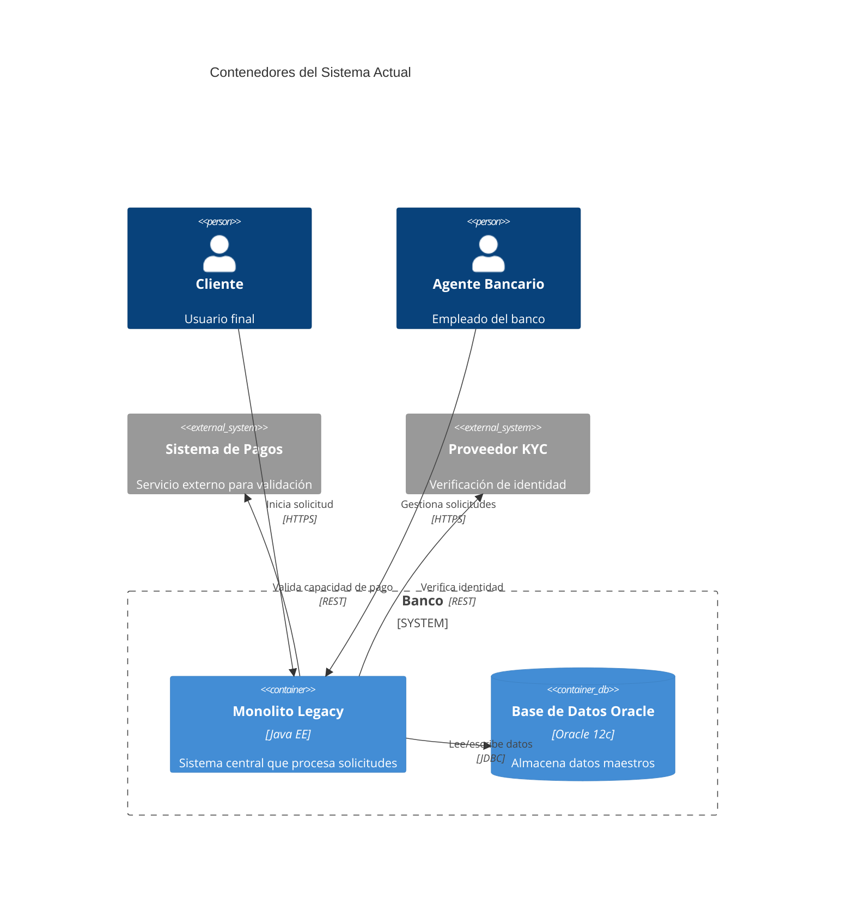

# Arquitectura del Sistema de Originación Digital

## 1. Vista de Contexto
El sistema actual (as-is) está basado en un monolito legado con las siguientes características:
- **Sistema Legacy Core Bancario**: Procesa todas las transacciones y almacena datos maestros.
- **Sucursales Físicas**: Puntos de contacto principales para clientes.
- **Proveedores Externos**: Servicios de KYC y scoring crediticio.
- **Sistema de Pagos**: Validación de capacidad de pago.

El diagrama de contexto (`diagramas/contexto.mmd`) muestra las interacciones actuales entre estos actores.

> **Preguntas guía**:
> - ¿Qué actores adicionales deberían incluirse en el contexto del sistema propuesto?
> - ¿Cómo afectan las restricciones técnicas y de negocio a las interacciones entre actores?

## 2. Vista de Contenedores (Sistema Actual - As-Is)
El sistema actual se compone de los siguientes contenedores:



### Limitaciones del Sistema Actual
- **Rendimiento**: El monolito no escala horizontalmente, limitando el throughput.
- **Disponibilidad**: Dependencia de la base de datos Oracle (SPOF).
- **Resiliencia**: Sin mecanismos de fallback para dependencias externas.
- **Seguridad**: Datos sensibles en texto plano; falta de cifrado en tránsito.

> **Preguntas guía para la Vista To-Be**:
> - ¿Qué contenedores propondrías para reemplazar el monolito?
> - ¿Cómo garantizarías la escalabilidad y resiliencia de cada contenedor?
> - ¿Qué patrones arquitectónicos aplicarías (ej. microservicios, serverless)?

## 3. Vista de Contenedores (Sistema Propuesto - To-Be)
> **Preguntas guía**:
> - Dibuja los contenedores de la solución propuesta usando Mermaid.
> - Incluye:
>   - API Gateway
>   - Microservicios (originación, scoring, KYC)
>   - Bases de datos (SQL/NoSQL)
>   - Colas de mensajes (Kafka, SQS)
>   - Servicios serverless (Lambda, Step Functions)
>   - Cache (Redis, DynamoDB)
> - ¿Cómo interactúan los contenedores entre sí?
> - ¿Qué protocolos de comunicación usarías (REST, gRPC, eventos)?

## 4. Vista de Componentes
### Componente: API de Originación
**Responsabilidades**:
- Validar solicitudes de clientes.
- Orquestar flujos con otros servicios.
- Manejar errores y reintentos.

> **Preguntas guía**:
> - ¿Qué componentes internos tendría la API de originación?
> - ¿Cómo se comunica con otros contenedores (ej. scoring, KYC)?
> - ¿Qué patrones usarías para manejar la resiliencia (ej. circuit breaker, retry)?

### Componente: Servicio de Scoring
**Responsabilidades**:
- Calcular score crediticio.
- Integrar con proveedores externos.

> **Preguntas guía**:
> - ¿Cómo garantizarías la consistencia eventual en el scoring?
> - ¿Qué estrategias usarías para manejar latencias altas en proveedores externos?

## 5. Vista de Despliegue
### Infraestructura Actual (As-Is)
- Todo el sistema se despliega en un único data center.
- Base de datos Oracle en servidor dedicado.
- Monolito desplegado en servidores físicos.

> **Preguntas guía para la Vista To-Be**:
> - ¿Cómo desplegarías la solución en múltiples regiones de AWS?
> - ¿Qué servicios de AWS usarías para cada contenedor?
> - ¿Cómo garantizarías la alta disponibilidad y tolerancia a fallos?
> - ¿Qué estrategias de despliegue usarías (blue/green, canary)?

### Ejemplo de Despliegue Propuesto
```mermaid
%% Diagram: Despliegue To-Be
C4Deployment
  title Despliegue Multi-Región en AWS
  Region(us-east-1, "us-east-1", "AWS") {
    Deployment_Node(apigw, "API Gateway", "AWS API Gateway")
    Deployment_Node(ecs, "ECS Cluster", "Amazon ECS") {
      Container(originacion, "Microservicio Originación", "Docker")
      Container(scoring, "Microservicio Scoring", "Docker")
    }
    Deployment_Node(dynamodb, "DynamoDB", "Amazon DynamoDB")
    Deployment_Node(redis, "ElastiCache", "Redis")
  }
  Region(us-west-2, "us-west-2", "AWS") {
    Deployment_Node(ecs_west, "ECS Cluster", "Amazon ECS") {
      Container(originacion_west, "Microservicio Originación", "Docker")
    }
    Deployment_Node(dynamodb_west, "DynamoDB", "Amazon DynamoDB")
  }

  Rel(apigw, originacion, "Rutea solicitudes", "HTTPS")
  Rel(originacion, scoring, "Solicita scoring", "gRPC")
  Rel(originacion, dynamodb, "Almacena datos", "DynamoDB")
  Rel(originacion, redis, "Cache", "Redis")
  BiRel(originacion, originacion_west, "Replicación", "Kinesis")
```

> **Preguntas guía**:
> - ¿Cómo manejarías la consistencia de datos entre regiones?
> - ¿Qué servicios de AWS usarías para monitoreo y logging?
> - ¿Cómo implementarías la recuperación ante desastres (DR)?

## 6. Decisiones Arquitectónicas Clave
> **Preguntas guía**:
> - ¿Qué patrones arquitectónicos usarías para cumplir los ASRs?
> - ¿Cómo asegurarías la resiliencia y disponibilidad del sistema?
> - ¿Qué estrategias de seguridad implementarías para cumplir con PCI DSS?